

# Materiales para Primaria

Juegos y programas educativos de uso público para niños de 1.º a 6.º de primaria. Están alineados al Programa Curricular de Educación Primaria (EBR, Perú).

- `materialalumno/grado-1` … `grado-6`: juegos y actividades para alumnos
- `materialdocente/grado-1` … `grado-6`: herramientas para docentes

En [METODO.md](METODO.md) se explica cómo está organizado y qué métodos se usan.
